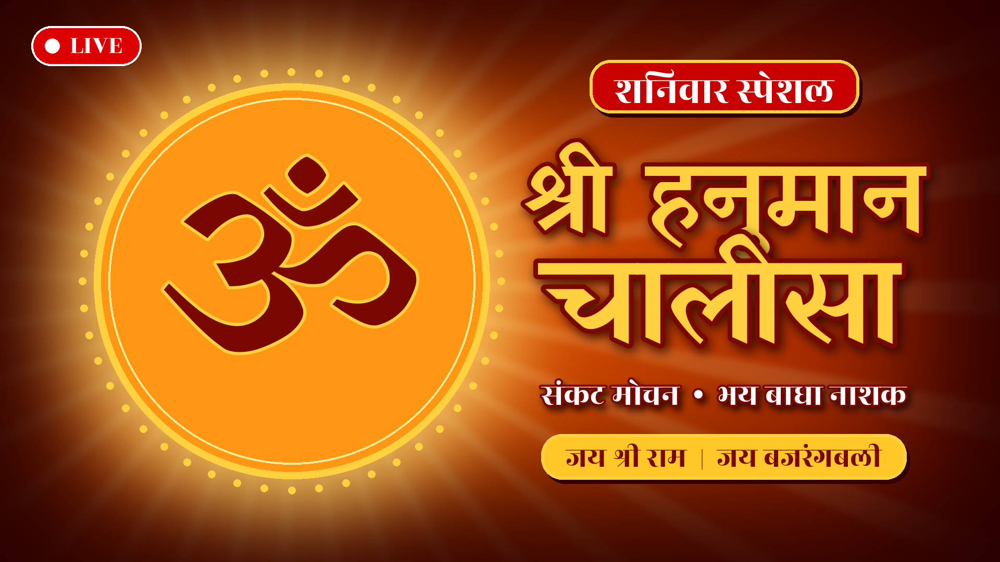

# Hanuman Chalisa – Shanivar Special template



Turns a Hanuman Chalisa song into a YouTube-ready MP4 with a "शनिवार स्पेशल"
cover, plus a thumbnail and copy-paste title / description / tags
([metadata.md](metadata.md)). The MP4 can be uploaded as a normal video or
looped into a live stream.

Needs `ffmpeg` and Python 3 with Pillow (`pip install pillow`).

## 1. Cover + thumbnail

```bash
python3 make_cover.py                       # out/cover.png + out/thumbnail.jpg
python3 make_cover.py --image hanuman.png   # put a Hanuman ji picture in the halo
python3 make_cover.py --no-live             # without the LIVE badge (normal upload)
```

## 2. MP4

```bash
./make_video.sh song.mp3                    # plays once
./make_video.sh song.mp3 out/cover.png 11   # 11 times back-to-back
```

Output `out/hanuman-chalisa-shanivar-special.mp4`: H.264 High, 1920x1080,
30 fps, keyframe every 2 s, AAC 192 kbps 48 kHz — YouTube's recommended
settings for both uploads and live ingest.

## 3. Live stream on your channel

```bash
cd ../..                                     # repo root
python3 yt_api.py key spiritual hanuman      # once: prints the RTMP key
python3 yt_api.py go-live spiritual hanuman \
  "🔴 LIVE शनिवार स्पेशल श्री हनुमान चालीसा | Hanuman Chalisa Live | 25 October 2026"

# push the MP4 on loop (no re-encode)
ffmpeg -re -stream_loop -1 -i templates/hanuman-chalisa/out/hanuman-chalisa-shanivar-special.mp4 \
  -c copy -f flv "rtmp://a.rtmp.youtube.com/live2/$YT_KEY_SPIRITUAL"
```

Or in YouTube Studio → **Go live → Stream**, copy the stream key and use it in
the ffmpeg command above. Set the thumbnail, description and tags from
[metadata.md](metadata.md).

Only stream audio you have the rights to (your own recording or properly
licensed) — otherwise Content ID can mute or stop the live stream.

Fonts: Yatra One and Rozha One, SIL Open Font License ([fonts/OFL.txt](fonts/OFL.txt)).
